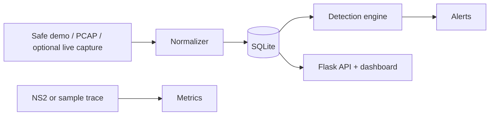

# Architecture

The application separates capture, normalization, analysis, detection, monitoring, reporting, simulation, and web presentation. SQLite stores only header-derived data.

All API input is validated, reports are path-confined, and payloads are intentionally discarded.

